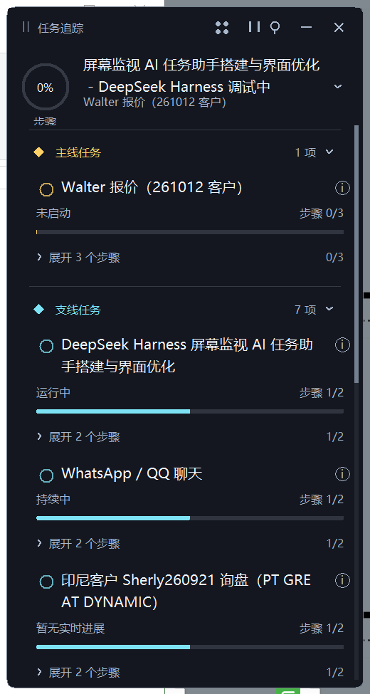
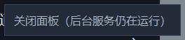

# 任务追踪 HUD（Quest Monitor）

一个常驻桌面的"游戏任务面板"：后台记录你在用什么窗口，本地大模型据此判断你正在做什么任务，把主线/支线任务挂在屏幕右上角的悬浮窗里。

做报价时突然接到客户订单、转去整理包材——面板会自动挂出一条支线「XX 客户包材整理中」，做完再回到主线。

## 为什么做这个

一个人干活时最容易丢的不是时间，是**方向**：上午列了三家客户的报价，中途一封邮件进来就去处理包材，回头已经忘了原始那件事干到哪一步。

这个面板解决的是"我现在该干什么、我跑偏了没有"。

## 结构

```
quest-monitor/
├── engine/
│   ├── win_watch.py     # 窗口看门：前台窗口标题 + 进程名 + 空闲秒数，写 win_log.jsonl
│   ├── llm_engine.py    # 主循环：压缩轨迹 → 调本地 LLM → 合并写状态
│   ├── state_store.py   # 状态层：文件锁、原子写、用户操作与 AI 结果合并
│   └── ctl.py           # 进程控制：pause / resume / panel / status
├── ui/
│   └── quest_window.py  # tkinter 悬浮窗（四皮肤、贴边把手、进度环、时间轴）
├── config/
│   ├── llm.json         # 模型地址、模型名、分析间隔
│   └── quest_state.json # 任务状态（运行时生成）
└── restart_all.ps1      # 重启面板 + 按需恢复后台服务
```

一次循环：`win_watch` 每 2 秒采样前台窗口 → `llm_engine` 每 60 秒读最近轨迹、压成"专注段" → 请求本地 OpenAI 兼容接口 → 拿到 `{changed, state}` → 与磁盘状态合并 → `ui` 每 3 秒刷新。

## 三个设计取舍

**1. 先看窗口标题，再看屏幕**

窗口标题形如 `Offer 261029.xlsx - WPS Office`，纯文本就能推断任务，比截图省几个数量级的 token。只有标题看不出东西时才需要截图（当前版本未启用截图）。

**2. 轨迹按"专注段"压缩**

40 条窗口记录直接发过去是 2043 字符；合并连续同窗口、丢弃 <5 秒抖动、给每段算停留时长之后是 438 字符、10 段。实测每轮输入从约 5000 token 降到约 840，每小时约 5 万 token。

**3. 用户的手动操作不可被 AI 覆盖**

点勾选、标完成都记进任务内的 `_user_state`（包含显式的 `false`）。AI 返回结果时先重读磁盘最新状态再合并——60 秒模型调用期间用户的操作不会丢，过期的 AI 响应也不会把用户刚取消的勾又勾回去。

## 界面

- 默认折叠：进度环 + 当前行动 + 主线名
- 点开：主线/支线任务、每项进度条、可展开的步骤、下一步建议、已完成时间轴、今日回顾
- 顶栏：皮肤（深蓝玻璃 / 轻透悬浮 / 杂志手账 / 夜航 HUD）、暂停、图钉、收起、关闭
- 贴边后鼠标移开自动缩成 20×68 竖把手，移回展开，图钉可固定
- 任务左侧圆点 = 完成/恢复；标题区 = 展开步骤（分开是为了避免点标题时误标完成）

## 运行

需要 Windows、Python 3.10+，无第三方依赖（纯标准库 + ctypes）。界面需要 tkinter（Python 官方安装包自带）。

```powershell
# 配置模型地址
copy config\llm.example.json config\llm.json   # 改成你的 base_url / api_key / model

# 起面板和后台服务
python engine\ctl.py panel
python engine\ctl.py resume

# 查看状态 / 暂停 / 继续
python engine\ctl.py
python engine\ctl.py pause
python engine\ctl.py resume
```

`llm.json` 指向任何 OpenAI 兼容的 `/v1/chat/completions` 接口。本地小模型（如 Ollama、LM Studio、vLLM）也能用，提示词里要求的输出是严格 JSON。

## 暂停与开销

点顶栏暂停会真的杀掉采样与 LLM 两个进程，只留面板本身——因为面板要继续刷新才能显示"已暂停"并让你点继续。暂停状态落盘到 `config/paused`，重启后不会自动恢复消耗。

面板关闭时（`config/panel_alive` 心跳停止）引擎会在 20 秒内自动休眠，不会在没人看的时候继续烧 token。

## 已知限制

- 只靠窗口标题和停留时长推断，读不到文档内容，所以"这一页写到哪里了"这类进度它猜不准
- 不估算工作量，进度条要么来自显式进度字段，要么来自勾选步骤比例，否则显示"待估算"
- 任务状态只有 `active` / `pending` / `done`，等待对方回复这类状态暂无
- 模型判断有主观性，任务被拆得不对时需要手动改

## 截图

| 展开 | 折叠 |
| --- | --- |
|  |  |
